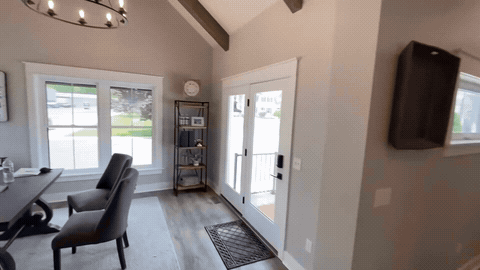
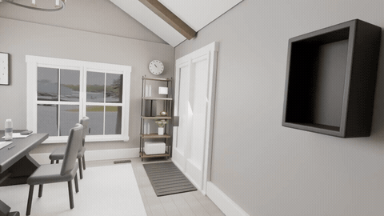
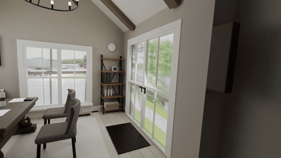

# AHa-3D: Agentic Tool Use for Real2Sim with GPT-6 Astra

**[Project page](https://kevinxu02.github.io/real2sim-indoor-site/)** ·
[Getting started](docs/GETTING_STARTED.md) · [Documentation index](docs/INDEX.md)

AHa-3D reconstructs indoor videos as editable Blender scenes, with room geometry,
furniture, recovered cameras and optional people. Models estimate geometry and
motion; a coding agent authors the room, reviews intermediate results and refines
contacts. Saved scenes can be rendered or exported as interactive browser demos.

Start by giving your coding agent a reconstruction request. It handles setup,
geometry estimation, scene authoring, review and delivery.

| **Original video** | **Astra without the harness** | **Astra with the harness** |
| --- | --- | --- |
|  |  |  |

## News

- **2026-10-27** — Added an [office reconstruction walkthrough](https://github.com/KevinXu02/aha-3d/blob/main/docs/GETTING_STARTED.md), with a bundled source video, agent prompts and Gallery/X-ray refinement. For the previous code, see the [legacy branch](https://github.com/KevinXu02/aha-3d/tree/legacy).

## Getting started

Follow [Getting started](docs/GETTING_STARTED.md) to explore the office example
in the Gallery, ask the agent to reconstruct it, and request changes. It provides
copyable prompts; the agent runs the workflow.

<details>
<summary>Setup reference for agents and developers</summary>

## Setup

Run from the repository root on Linux (Ubuntu or WSL2), with Python 3.11,
FFmpeg and an NVIDIA GPU/driver compatible with the installer’s CUDA 12.8 wheels.
Use Blender 5.2 for the supplied scene libraries; human skinning additionally
uses Blender 4.5 and its SMPL-X extension. See [prerequisites](docs/SETUP.md#1-prerequisites).
A 24 GB GPU is the target; prior validation used 96 GB, so smaller-card coverage
and runtime are not guaranteed. See [runtime limits](MACHINE.md).

Choose the installation route for your task:

| Task | Installer level | Additional setup |
| --- | --- | --- |
| Room/reference geometry and cameras | `static` | [Pi3X weights](docs/install/pi3x.md#download-authorized-weights), [SAM3 weights/runtime](docs/PI3X_GEOMETRY_REFERENCE.md#runtime), [Blender](docs/install/blender.md) |
| Reconstruct people from the source video | `human` | Static plus [PMPose, GVHMR, body assets and skinning](docs/install/human-motion.md) |
| Generate new robot motion | `robotics` | Static plus [Kimodo, G1 and text models](docs/install/kimodo.md) |

For room reconstruction:

```bash
bash tools/setup.sh --level static --plan  # Inspect without installing
bash tools/setup.sh --level static
```

The installer prepares code and Python environments. **Download the Pi3X and SAM3
weights using the links above before inference**; weights and Blender are separate.
Human setup also needs the separate PMPose/GVHMR installation steps. Generated
human actions use Kimodo's SMPL-X model, described in the Kimodo guide.

Default runtime locations are under `.runtime/`; use [setup](docs/SETUP.md) for
custom paths and keep machine configuration in ignored local files. Model access
and distribution terms are listed in [third-party dependencies](THIRD_PARTY.md).

</details>

## Which documentation should I read?

| Audience | Start here | Read as needed |
| --- | --- | --- |
| Users | This README, [Getting started](docs/GETTING_STARTED.md) | [Installation](docs/INSTALLATION.md), [setup](docs/SETUP.md), [reference inference](docs/PI3X_GEOMETRY_REFERENCE.md), [examples](examples/README.md), [results](docs/RESULTS.md) |
| Developers | [Git workflow](docs/GIT_WORKFLOW.md), [coordination](docs/COORDINATION.md) | [Pipeline](docs/PIPELINE.md), `src/aha3d/`, `tools/`, `tests/`; run `python tools/verify_package.py` for source/package checks |
| Agents | [AGENTS.md](AGENTS.md), [task routing](docs/INDEX.md), [skill index](TOOLS_AND_SKILLS.md) | The current skill under `.agents/skills/`, [scene workflow](docs/SCENE_WORKFLOW.md), [acceptance](docs/WORKFLOW_ACCEPTANCE.md) |

Use the [documentation index](docs/INDEX.md) for specific operations such as
asset replacement, materials, motion refinement and rendering. The
[asset catalog](assets/INDEX.md) lists reusable furniture and materials.
Historical reports in `docs/lessons/` provide context, not current execution defaults.

## License

Project-authored code, skills and assets are licensed under the
[Apache License 2.0](LICENSE). See [distribution notes](DISTRIBUTION.md) and
[third-party dependencies](THIRD_PARTY.md) for separately acquired models and assets.
