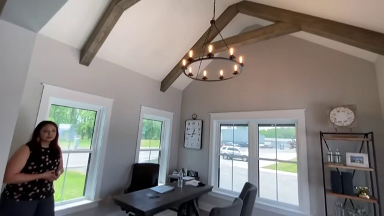

# Getting started

Open this repository in your coding agent and describe the result you want.
The agent handles setup, reconstruction, visual checks and delivery. This guide
uses the included office video as an example of that workflow.

## 1. Explore the supplied result

Ask the agent:

> Show the included office example in the Gallery. Use
> references/office48/source.mp4 as the source video,
> docs/media/office48_whitebox.mp4 as the reconstruction preview, and
> examples/office48/whitebox.blend as the editable scene.
> Set up the Gallery if needed and give me the link.

Browse the result and compare it with the source. You can also open the
[supplied render](media/office48_whitebox.mp4) directly. Use Blender
when you want to edit the [scene](../examples/office48/whitebox.blend).

## 2. Ask the agent to reconstruct it

Use this prompt to make a new reconstruction from the same video:

> Use this repository's workflow to reconstruct references/office48/source.mp4. Exclude the human.

The agent asks about any missing requirements, then handles setup and execution.

## 3. Review and refine in the Gallery

Open the Gallery link from the agent. Compare the reconstructed room with the
source, especially furniture placement, the ceiling beams and camera framing.
The handoff should include the editable `.blend`, rendered video and preview
images, with any remaining approximations explained.

Ask the agent to use X-ray views to refine a specific object, for example:

> Use X-ray views to further refine the desk, matching its shape and placement
> to the source video. Update the result in the Gallery.

The agent updates the affected stages and delivers the revised result.

## 4. Try another task

Use the same workflow with your own video by replacing the source path and
describing the room, appearance, camera and people you want included.

To extend the office example, ask for the change you want:

- **Source people:** "Include the person from the original video, preserving their
  observed motion and matching their placement and contacts with the room."
- **Materials:** "Add materials matching the source while preserving the reviewed
  geometry, camera and timing."
- **Interactive demo:** "Export this result as an interactive browser demo and
  add its link to the Gallery."

Installation, commands and stage details are available in the
[documentation index](INDEX.md) for agents and developers.
